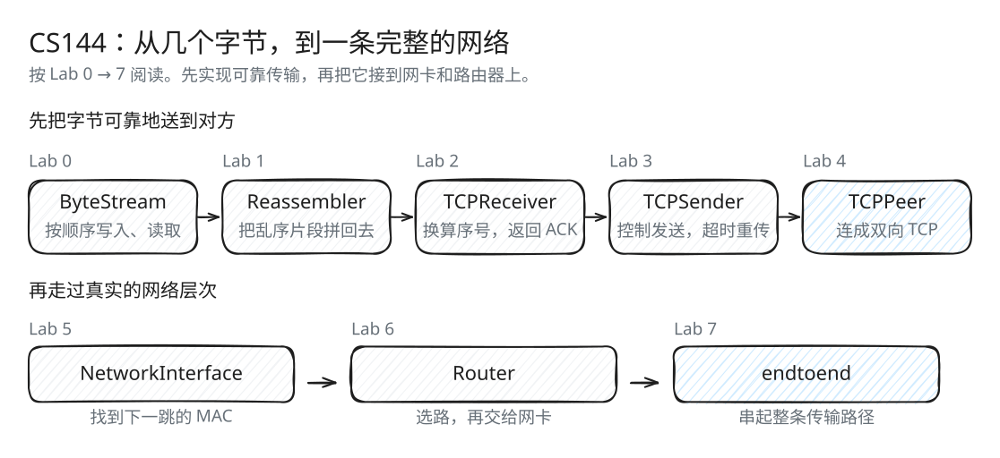

# CS144 Lab 0–7：从字节流到完整网络

一个可靠的字节流是怎样从不可靠的网络中建立起来的？这组笔记沿着 CS144 的实验顺序，从内存里的几个字节讲到两台主机之间的文件传输。图解、例子和实现说明都对应本仓库的代码；文件名沿用课程的 `check0` 到 `check7`。

## 学习路线



[SVG 原图](assets/lab-roadmap.svg) · [Excalidraw 源文件](assets/lab-roadmap.excalidraw)

| Lab | 要解决的问题 | 图解重点 | 文档 |
| --- | --- | --- | --- |
| 0 | 一次写入能接收多少？关闭后为什么还能读？ | 容量、块队列、读完与关闭 | [HTTP 与 ByteStream](check0.md) |
| 1 | 后半段先到，什么时候才能交给应用？ | 接收窗口、重叠裁剪、EOF 先到 | [Reassembler](check1.md) |
| 2 | 为什么 SYN、字节下标和 ACK 的数字不一样？ | 三套编号、回绕还原、累计 ACK | [TCPReceiver](check2.md) |
| 3 | 发出去却没收到 ACK，什么时候还能继续发？ | 在途量、发送窗口、重传计时 | [TCPSender](check3.md) |
| 4 | 一条报文怎么既传数据，又确认反方向的数据？ | 报文分派、连接建立、半关闭 | [TCP 连接](check4.md) |
| 5 | 知道目的 IP 后，为什么还要找 MAC？ | ARP 时序、下一跳与最终目的地 | [NetworkInterface](check5.md) |
| 6 | 多条路由都匹配，该选哪条？ | 最长前缀、TTL、每一跳换帧 | [Router](check6.md) |
| 7 | UDP 不保证可靠，为什么实验仍能可靠传文件？ | 两端拓扑、协议封装、完整路径 | [endtoend](check7.md) |

第一次接触这些实验，建议按 Lab 0 → 7 阅读；已有实现经验，可以直接查找关心的问题。Lab 4 和 Lab 7 重点讲组件如何接起来。

## 先认清数据和反馈的方向


[SVG 原图](assets/tcp-architecture.svg) · [Excalidraw 源文件](assets/tcp-architecture.excalidraw)

每个端点都有自己的 Sender 和 Receiver。应用写入的数据由 Sender 发出；收到的数据经 Receiver 和 Reassembler 整理后交给应用。ACK 沿着相反方向返回：本地 Receiver 确认对方发来的数据，对方 Receiver 确认本地发出的数据。

`webget`、`tcp_ipv4` 通过 TUN 把 IPv4 数据报交给 Linux 网络。`endtoend` 使用自己实现的网卡和路由器，外侧链路由 UDP 承载以太网帧。读到 Lab 7 时再展开这条路径。

## 三个容易混淆的区别

| 要分清的概念 | 判断方法 | 详细说明 |
| --- | --- | --- |
| 连续收到 / 应用已读取 | 连续收到推进 ACK；应用读取释放容量 | [接收窗口](check1.md#接收窗口如何计算)、[累计 ACK](check2.md#例子乱序不会推进累计-ack) |
| 流下标 / 绝对序号 / 线上序号 | 下标只数载荷；绝对序号包含 SYN、FIN；线上序号还加 ISN 并回绕 | [三套编号](check2.md#三套编号) |
| 最终目的 IP / 下一跳 IP / 目的 MAC | 最终目的地在 IPv4 中；路由选择下一跳；ARP 找当前链路目的 MAC | [下一跳](check5.md#下一跳-ip-与最终目的-ip)、[路由转发](check6.md#有网关与直连的差别) |

文中统一使用半开区间 `[begin, end)`：包含 `begin`，不包含 `end`，长度为 `end - begin`。ISN 是初始序号，ACK 指下一个需要的序号，RTO 是重传超时时间，EOF 表示字节流的结尾。

## 怎样把图和源码对应起来

先用例子推演一遍，再看源码里的状态如何变化：谁保存它，哪次调用更新它，更新后还应满足什么关系。

例如，ByteStream 始终满足 `buffered = pushed - popped`，Reassembler 的缓存片段互不重叠，Sender 的确认进度不会超过发送进度。抓住这些关系，就容易理解每一步操作的理由。遇到 `optional`，还要区分“未知”和“值为 0”：流终点与 ISN 都可能合法地取 0。

图解由 Excalidraw 导出，使用手绘线条、手写字体和少量颜色标出重点。每张图都附有可编辑源文件，完整目录与编辑方法见 [图解索引](assets/README.md)。

## 构建与测试

在仓库根目录运行：

```bash
cmake -S . -B build
cmake --build build --target all functionality_testing speed_testing -j 4
```

运行本地功能测试，无需 TUN 或管理员权限：

```bash
ctest --test-dir build --output-on-failure --timeout 12 -FA compile -E '(^t_webget$|compile|_speed_test)'
```

当前测试配置选择 37 项 ASan/UBSan 测试，包括各组件测试、随机重排、协议回归和双向 TCP 集成。测试检查的具体行为见各 Lab 的“验证方式”。

性能检查：

```bash
ctest --test-dir build --output-on-failure --timeout 12 -FA compile_opt -R '_speed_test$'
```

`-FA compile` 和 `-FA compile_opt` 用于跳过编译 fixture，因为上面已经构建对应程序。若未预先构建，省略相应 `-FA` 参数，让 CTest 自动编译。

仓库提供 `check0`、`check1`、`check2`、`check3`、`check5`、`check6` 目标，范围见 [etc/tests.cmake](../etc/tests.cmake)。`check0` 包含需要 TUN 的实网测试；先学 ByteStream 时可只运行 [Lab 0 的本地测试](check0.md#验证方式)。Lab 4 用 [TCP 集成测试](check4.md#本地集成验证)，Lab 7 用 [本地完整路径实验](check7.md#可复现的本地转发器)。
