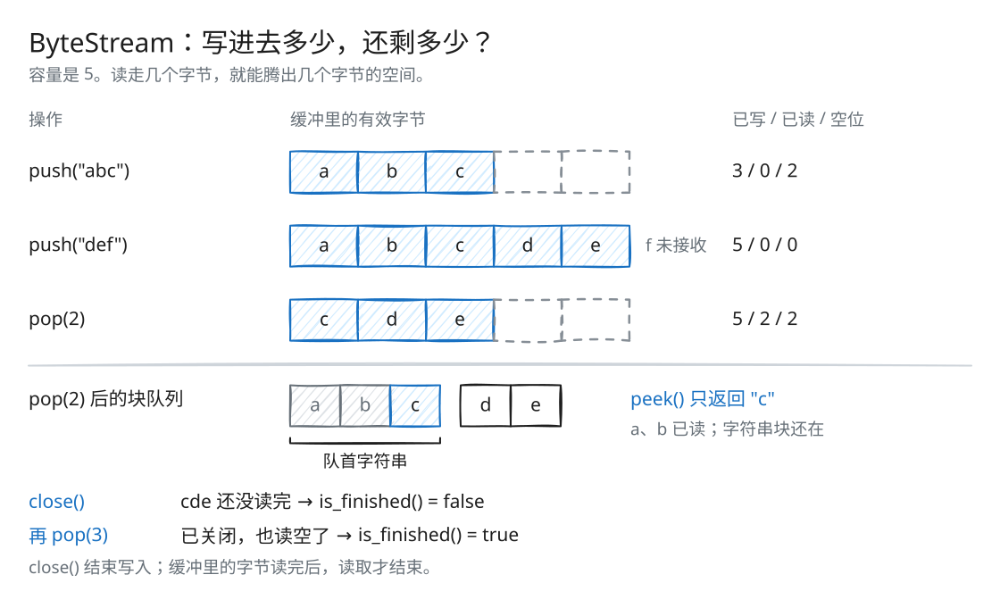

# Lab 0：HTTP 客户端与 ByteStream

[返回导读](README.md) · [下一篇：Lab 1](check1.md)

向字节流写入一段数据，不代表一次就能读出全部内容。缓冲区可能装不下，读取时也可能只拿到其中一块。Lab 0 先通过 HTTP 客户端观察分次读写，再实现一个有容量限制、按写入顺序读取的 ByteStream。

## 先认识 Writer 与 Reader

Writer 负责写：`push()` 放入数据，`close()` 表示写入结束。Reader 负责读：`peek()` 查看队首，`pop()` 移除已读字节。两者操作的是同一个 ByteStream。

容量限制的是“已经接受但尚未消费”的字节。写入超过容量时，只接受能装下的前缀；后缀由调用者保留，等容量恢复后重试。

## 用一个例子跟踪状态



[SVG 原图](assets/byte-stream.svg) · [Excalidraw 源文件](assets/byte-stream.excalidraw)

容量为 5，依次执行：

| 操作            | 缓冲内容          | 累计写入 | 累计弹出 | 可用容量 |
| ------------- | ------------- | ---: | ---: | ---: |
| `push("abc")` | `abc`         |    3 |    0 |    2 |
| `push("def")` | `abc`、`de`    |    5 |    0 |    0 |
| `pop(2)`      | `c`、`de`      |    5 |    2 |    2 |
| `peek()`      | 返回 `"c"`，内容不变 |    5 |    2 |    2 |
| `close()`     | 内容不变，写入结束     |    5 |    2 |    2 |
| `pop(3)`      | 空             |    5 |    5 |    5 |

第二次写入的 `f` 没有被接受。`close()` 后仍可读到剩余数据；只有“已关闭且缓冲为空”时，`is_finished()` 才为真。

图的上半部分展示容量用了多少，下半部分展示这些字节实际存在哪几个字符串块里。

## HTTP 请求流程

`get_URL(host, path)` 连接主机的 HTTP 端口，发送：

```text
GET <path> HTTP/1.1\r\n
Host: <host>\r\n
Connection: close\r\n
\r\n
```

`\r\n` 是 HTTP 头部的行分隔符，最后的空行结束请求头。`Host` 指明请求的主机；`Connection: close` 请求服务器在响应完成后关闭连接。

随后循环读取套接字，直到 EOF，把读到的内容写入标准输出。网络读取可能只返回响应的一部分，因此不能用一次 `read()` 代替循环。这个实现输出完整 HTTP 响应，包括状态行和头部，没有额外解析响应体。

后面的 ByteStream 也遵循同样的读法：每次取出一部分，直到读完。

## 源码位置

| 文件 | 作用 |
| --- | --- |
| [apps/webget.cc](../apps/webget.cc) | 构造 HTTP 请求，读取并输出响应 |
| [src/byte_stream.hh](../src/byte_stream.hh) | ByteStream 状态与 Reader、Writer 接口 |
| [src/byte_stream.cc](../src/byte_stream.cc) | 写入、查看、弹出、计数和关闭 |
| [src/byte_stream_helpers.cc](../src/byte_stream_helpers.cc) | 框架提供的读写视图和 `read()` 辅助函数 |

初始 Lab 0 使用 Linux 的 `TCPSocket`。当前 [webget.cc](../apps/webget.cc) 已在后续集成中改用 `CS144TCPSocket`，HTTP 逻辑仍相同，但传输经过自己实现的 TCP 栈，因而当前实网运行需要 `tun144`。

## 数据结构与不变量

`buffer_` 是一个 `queue<string>`，每次写入的数据各占一个字符串块。`remaining_front_bytes` 记录队首还剩多少字节；只读走一部分时，更新这个计数即可。

| 字段 | 含义 |
| --- | --- |
| `capacity_` | 字节流的逻辑容量 |
| `bytes_buffer_` | 当前可读但尚未弹出的字节数 |
| `bytes_pushed_` | 累计接受的字节数 |
| `bytes_popped_` | 累计弹出的字节数 |
| `remaining_front_bytes` | 队首字符串的未读长度 |
| `close_` | 生产者是否已经声明写入结束 |
| `error_` | 流是否处于错误状态 |

始终保持：

```text
bytes_buffer_ = bytes_pushed_ - bytes_popped_
available_capacity = capacity_ - bytes_buffer_
0 <= bytes_buffer_ <= capacity_
```

Reader 与 Writer 是同一个 ByteStream 的两种接口视图，状态都存放在 ByteStream 中。框架的 `reader()`、`writer()` 返回相应引用，课程要求这两个派生接口不要增加状态成员。

## Writer::push()

本次真正能接收的长度为：

```text
accepted = min(available_capacity(), data.size())
```

若长度非零，累计写入量与当前缓冲量增加 `accepted`，然后将有效数据入队。

- 全部接收时，移动字符串，避免再次复制载荷。
- 只接收一部分时，用 `substr(0, accepted)` 保存有效前缀，避免为一小段数据保留整个输入字符串的内存。
- 若入队后只有一个字符串，说明它是新的队首，将 `remaining_front_bytes` 设为它的长度。

超出容量的后缀不计入 `bytes_pushed_`，由调用者保留，等有空间后再提交。

## Reader::peek() 与 pop()

`peek()` 返回队首未读部分的 `string_view`：

```text
起始偏移 = front.size() - remaining_front_bytes
长度     = remaining_front_bytes
```

它不复制数据，也不移除数据。队列为空时返回空视图。一次 `peek()` 只保证看到队首连续块，不保证看到所有已缓存字节。

`pop(len)` 先更新累计读取量与缓冲量，然后逐块消费：

1. `len` 小于队首剩余量：减少 `remaining_front_bytes`，本次完成。
2. `len` 足以消费队首：减去队首剩余量，弹出字符串，继续消费下一块。
3. 队列读空后，将 `remaining_front_bytes` 置为 0。

调用者保证 `len <= bytes_buffered()`。返回的 `string_view` 应在消费该块前使用，不能在弹出其所属字符串后继续引用。

## 为什么采用字符串块队列

单个大字符串会在前端删除时反复搬移剩余内容。块队列将大部分删除变成调整偏移或弹出整块，也方便后续 Reassembler 直接移动已连续的片段。

`peek()` 和状态查询是 O(1)。`pop()` 的工作量与跨过的块数相关。`push()` 完整接收通常只转移字符串所有权，裁剪时需复制有效字节。逻辑容量限制的是有效字节数，容器元数据和尚未消费完的队首分配仍有额外开销。

## 动手推演

容量为 4，依次执行 `push("ab")`、`push("cd")`、`pop(1)`。`bytes_buffered()` 和 `peek().size()` 各是多少？此时调用 `close()`，`is_finished()` 会返回什么？

<details>
<summary>核对答案</summary>

`bytes_buffered()` 是 3。`peek()` 只返回第一块剩下的 `"b"`，所以大小是 1。`close()` 后还有 `"bcd"` 待读，`is_finished()` 为 `false`；再执行 `pop(3)` 才为 `true`。

</details>

## 验证方式

先按 [导读](README.md#构建与测试) 构建，再运行：

```bash
ctest --test-dir build --output-on-failure --timeout 12 -FA compile -R '^byte_stream_' -E '_speed_test$'
ctest --test-dir build -V --timeout 12 -FA compile_opt -R '^byte_stream_speed_test$'
```

测试覆盖空流、容量裁剪、部分读取、跨块读取、多次写入、关闭与压力场景。

`cmake --build build --target check0` 还会运行当前 `webget` 实网测试，需要先配置 TUN。配置与清理步骤见 [Lab 4](check4.md#实网验证与临时-tun)。单独的 ByteStream 测试无需管理员权限。
