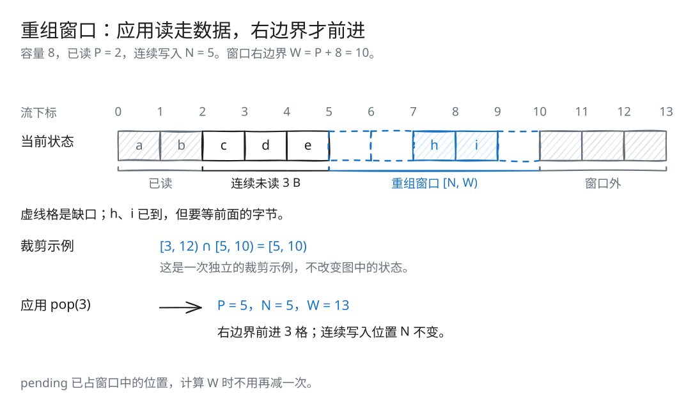
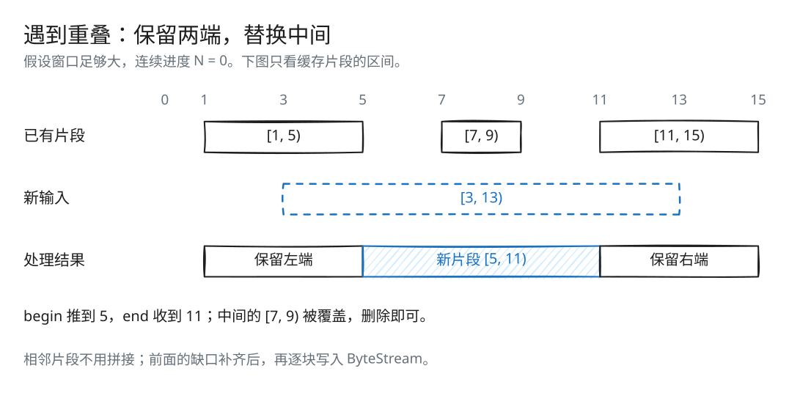
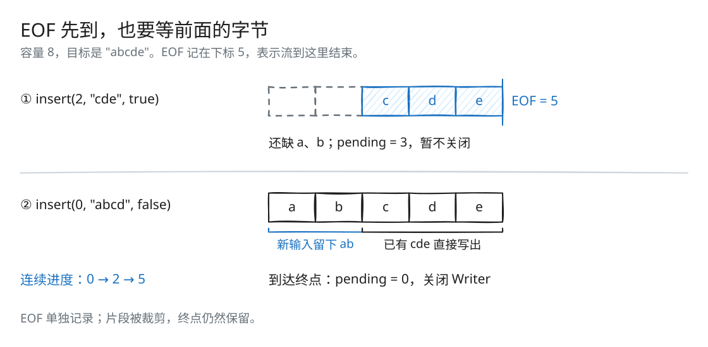

# Lab 1：将乱序片段重组为连续字节流

[返回导读](README.md) · [上一篇：Lab 0](check0.md) · [下一篇：Lab 2](check2.md)

网络可能先送来 `"cde"`，再送来 `"ab"`，还重复送来 `"bcd"`。应用需要的却只有一份按顺序排列的 `"abcde"`。Reassembler 根据流下标把片段放回原位：连续的数据写入 ByteStream，缺口后面的数据先存起来。

## 先分清三类字节

应用已经读走的字节不再占容量。连续、尚未读走的字节放在输出 ByteStream 中；缺口后面的乱序字节放在 Reassembler 的 `map` 中。

后两类字节共享同一个逻辑容量。缺口虽然还没收到数据，也占着窗口中的位置；窗口外的数据要等应用读取、窗口向前移动后才能接收。

## 接收窗口如何计算



[SVG 原图](assets/reassembly-window.svg) · [Excalidraw 源文件](assets/reassembly-window.excalidraw)

设：

```text
N = output.writer().bytes_pushed()
A = output.writer().available_capacity()
W = N + A
```

可接受的数据下标为 `[N, W)`。对于输入 `[first_index, first_index + data.size())`：

```text
begin = max(first_index, N)
end   = min(first_index + data.size(), W)
```

这同时裁掉已经写出的前缀和超过窗口的后缀。

为什么窗口右边界不是简单的“累计写入量 + 总容量”？因为 ByteStream 中尚未读取的数据也占空间。由 Lab 0 的计数关系：

```text
W = bytes_popped() + capacity()
```

因此只有应用读取后，窗口右边界才向前移动。乱序片段占用的是这个窗口里的具体位置，不能再次把 `pending_size_` 从右边界扣掉。已经连续但未读的字节与乱序字节总数不超过逻辑容量。

## 重叠片段怎样裁剪



[SVG 原图](assets/reassembly-overlap.svg) · [Excalidraw 源文件](assets/reassembly-overlap.excalidraw)

已有片段是 `[1, 5)`、`[7, 9)`、`[11, 15)`，新输入是 `[3, 13)`。处理时保留两端已有的片段：把新输入的 `begin` 推到 5，`end` 收到 11。中间的 `[7, 9)` 被新输入完整覆盖，删除它的节点即可。

最终新增 `[5, 11)`。此时三个片段首尾相接，仍可分开保存，等轮到它们输出时逐块移动。

## 例子：EOF 先到，前缀后到



[SVG 原图](assets/reassembly-eof.svg) · [Excalidraw 源文件](assets/reassembly-eof.excalidraw)

容量为 8，目标流是 `"abcde"`：

| 输入 | 写入输出 | 乱序缓存 | pending | 已知终点 |
| --- | --- | --- | ---: | --- |
| `insert(2, "cde", true)` | 空 | `[2, 5): "cde"` | 3 | 5 |
| `insert(0, "abcd", false)` | 先写 `"ab"`，再移动 `"cde"` | 空 | 0 | 5 |

第二个输入右端落在已有片段内，保留 `"cde"`，新输入只写 `"ab"`。连续进度从 0 到 2，再到 5，随后关闭。

整个过程只需依次写出 `"ab"` 和 `"cde"`，省去了拼接字符串的复制。

## 例子：窗口裁剪与重传

容量为 2，先收到 `insert(1, "bc", true)`。窗口是 `[0, 2)`，只能保留 `b`，终点 3 仍在窗口外，因此不记录 EOF。

再收到 `insert(0, "a", false)`，输出得到 `ab`，但流未结束。应用读走 `ab` 后，窗口推进；重传 `"bc"` 时，已经写出的 `b` 被裁掉，接受 `c` 和终点 3，流才关闭。

## 源码与状态

实现位于 [src/reassembler.cc](../src/reassembler.cc)，接口位于 [src/reassembler.hh](../src/reassembler.hh)。

| 字段 | 含义 |
| --- | --- |
| `output_` | 保存已经连续重组出的字节，供应用读取 |
| `buffer_` | `map<uint64_t, string>`，按起始下标保存未重组的片段 |
| `pending_size_` | map 内所有片段的有效字节数之和 |
| `end_index_` | `optional<uint64_t>`，已知流终点的排他下标 |

缓冲片段非空、按起始下标排序、彼此不重叠，相邻片段可以独立存在。函数结束时，最早缓冲片段仍与已重组前缀之间存在缺口；否则它已经被写入输出。

连续进度直接取 `output.writer().bytes_pushed()`，它就是下一个待写位置。

## 统一的插入流程

### 1. 记录可接受的 EOF

输入携带最后片段标记时，其原始终点为 `substring_end`。仅在：

```text
N <= substring_end <= W
```

时记录到 `end_index_`。EOF 是一个位置，不是数据字节，所以允许终点等于窗口右边界，也允许空字符串表示 EOF。尾部还在窗口外时不能提前确认流结束。

EOF 在重叠处理之前记录，避免片段被判为重复或被覆盖删除时失去终点信息。

### 2. 找到左右边界片段

对经过窗口裁剪的 `begin` 调用 `buffer_.upper_bound(begin)`。它之前的片段可能覆盖输入左端；将 `begin` 推进到该片段的结束位置，保留已有左边界片段。

从迭代器向右删除被输入完全覆盖的片段，并减去它们对 `pending_size_` 的贡献。若下一个片段延伸到输入右端之外，则将 `end` 缩到该片段的起点，保留已有右边界片段。

处理后只需保存 `[begin, end)`。如果输入完全重复，这个区间为空。

### 3. 接收最终有效区间

若 `begin < end`，此时才构造最终字符串：

- 区间与原输入完全一致：移动输入字符串。
- 发生窗口或重叠裁剪：用 `substr` 复制最终有效区间。

先算好最终区间，再截取一次字符串。

若 `begin == N`，直接写入 ByteStream；否则使用 `emplace_hint` 插入有序缓存，并增加 pending 字节数。连续输入不需要先创建 map 节点再马上删除。

### 4. 逐段推进连续前缀

从 map 的最早片段开始，只要：

```text
片段起点 == output.writer().bytes_pushed()
```

就减去其 pending 字节数，将字符串移动到 ByteStream，再删除节点。每次写出都会推进 Writer 的计数，下一块是否连续也由这个计数决定。

由于重叠已经在插入时处理，这里无须再裁剪片段或拼接字符串。

### 5. 统一处理关闭

最后检查：

```text
end_index_ == output.writer().bytes_pushed()
```

满足时关闭 Writer。空流、末尾重复片段、乱序 EOF 后补齐缺口，都经过同一个收尾判断。Reader 仍需消费输出缓冲，才会报告 `is_finished()`。

## 为什么 end_index_ 使用 optional

`nullopt` 表示还没有获得可接受的 EOF；`0` 表示已知这是空流。两者不能合并。

终点单独保存后，即使对应片段被覆盖或移出 `map`，EOF 信息也不会丢失。

## 复杂度与取舍

设当前缓冲片段数为 n，本次删除或写出的片段数为 k。查找为 O(log n)，定位后的节点删除和连续写出总计 O(k)，另加最终有效字符串的复制或所有权移动。

这种组织方式省去了逆序输入时反复拼接长字符串的成本，代价是每个片段都需要一个 `map` 节点。逻辑容量只统计有效字节，节点和字符串分配还会占用额外内存。

输入重叠部分按同一原始字节流处理，本实现不额外诊断重叠载荷内容冲突。

## 动手推演

容量为 4，先调用 `insert(2, "cd", true)`，再调用 `insert(0, "ab", false)`，期间应用没有读取。第二次插入后，pending、可用容量和 Writer 的关闭状态分别是什么？Reader 是否已经结束？

<details>
<summary>核对答案</summary>

输出是 `"abcd"`，pending 为 0，可用容量为 0，Writer 已关闭。Reader 还没有结束：四个字节都待读取，全部 `pop()` 后才结束。

</details>

## 验证方式

先按 [导读](README.md#构建与测试) 构建，再运行：

```bash
ctest --test-dir build --output-on-failure --timeout 12 -FA compile -R '^reassembler_' -E '_speed_test$'
ctest --test-dir build --output-on-failure --timeout 12 -FA compile -R '^protocol_regressions$'
ctest --test-dir build -V --timeout 12 -FA compile_opt -R '^reassembler_.*speed_test$'
```

原有测试覆盖窗口、空洞、重叠、重复和 EOF。[reassembler_stress_test.cc](../tests/reassembler_stress_test.cc) 用 100 个随机种子，每个 1000 次随机插入与读取，对照逐字节参考模型。

性能测试覆盖顺序、逆序、递增间隔片段和随机间隔片段。它们测量重组与读取路径，不是网络链路吞吐。
