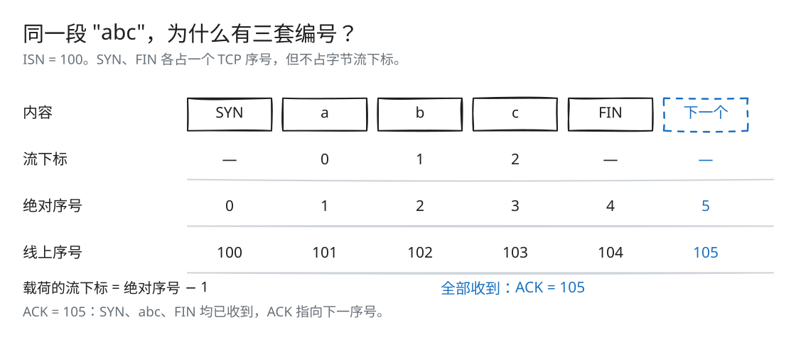
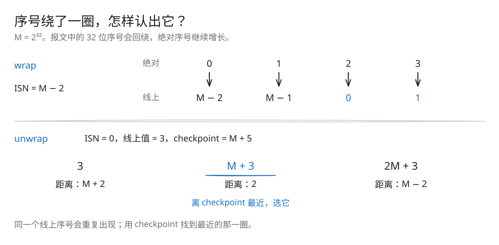
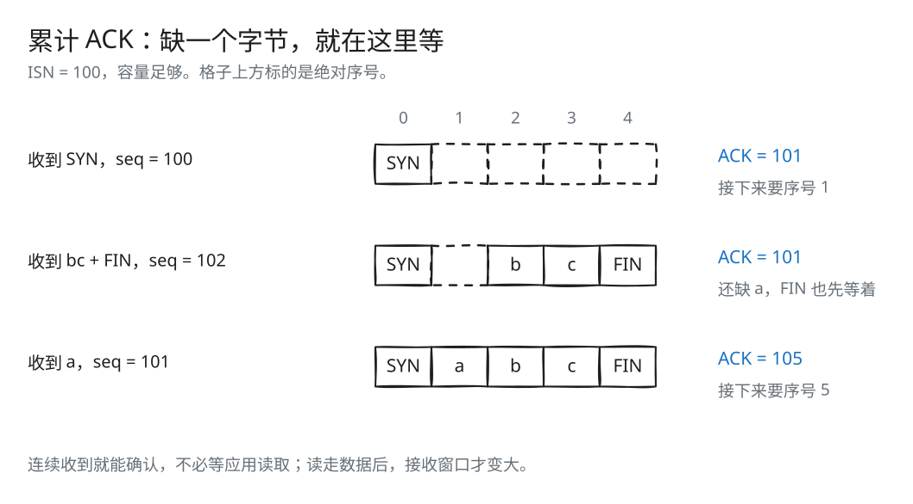

# Lab 2：回绕序号与 TCP 接收端

[返回导读](README.md) · [上一篇：Lab 1](check1.md) · [下一篇：Lab 3](check3.md)

Reassembler 只关心字节在流中的下标，TCP 报文使用的却是另一套编号：SYN、FIN 各占一个位置，序号达到 32 位上限后还会回绕。TCPReceiver 负责两边的换算，把载荷交给 Reassembler，再根据重组进度生成 ACK 和接收窗口。

## 三套编号



[SVG 原图](assets/sequence-space.svg) · [Excalidraw 源文件](assets/sequence-space.excalidraw)

以载荷 `"abc"` 为例：流下标是 0、1、2；绝对序号把 0 留给 SYN，所以三个字节占 1、2、3，FIN 占 4。若本方向 ISN 为 100，加上它后，报文中的序号就是 100–104。

全部接收后，下一个需要的绝对序号是 5，所以 ACK 为 105。ACK 的数值表示下一个位置，不是刚收到的最后一个位置。发送与接收方向各自有独立 ISN。

## 为什么需要 checkpoint



[SVG 原图](assets/sequence-wrap.svg) · [Excalidraw 源文件](assets/sequence-wrap.excalidraw)

32 位序号每经过 2³² 个位置就重复一次，只看报文中的数字，无法知道它属于哪一圈。checkpoint 提供当前的绝对进度，帮助 `unwrap()` 选出最近的一次。反过来，`wrap()` 只需取模，就能得到报文中的序号。

## Wrap32::wrap()

线上序号的关系为：

```text
seqno = (ISN + absolute_seqno) mod 2^32
```

实现先把绝对序号转换为 `uint32_t`，保留低 32 位，再通过 `Wrap32::operator+` 相加。无符号运算自然完成回绕，不需要判断是否跨过 `UINT32_MAX`。

例如 ISN 为 `2^32 - 2` 时，绝对序号 0、1、2、3 对应线上序号 `2^32 - 2`、`2^32 - 1`、0、1。

## Wrap32::unwrap()

同一个线上序号可能对应：

```text
offset, offset + 2^32, offset + 2 × 2^32, ...
offset = (seqno - ISN) mod 2^32
```

必须借助 checkpoint 选择距离最近的非负、可表示的绝对序号。

当前实现分三步：

1. 算出低 32 位的 `offset`。
2. 使用 checkpoint 的高 32 位与 offset 拼成当前回绕周期内的候选 `result`。
3. 候选距离 checkpoint 超过 `2^31` 时，向相邻周期调整一个 `2^32`。

候选大于 checkpoint 且距离过大，就尝试向前一个周期移动；候选小于 checkpoint 且距离过大，就尝试向后一个周期移动。实现同时保证调整不会变为负数，也不会超过 `UINT64_MAX`。

全部使用无符号范围，避免把合法的高位绝对序号转换为 `int64_t`。恰好相距半个周期时，两个候选同样近，实现保留当前周期的候选。

例如 offset 为 3、checkpoint 为 `2^32 + 5`，还原结果是 `2^32 + 3`，而不是 3。

`wrap()`、`unwrap()` 都是 O(1)。

## 例子：乱序不会推进累计 ACK



[SVG 原图](assets/receiver-ack.svg) · [Excalidraw 源文件](assets/receiver-ack.excalidraw)

ISN 为 100。收到 SYN 后，ACK 为 101；随后收到 seqno 为 102 的 `"bc"` 和 FIN，由于还缺 `a`，只能先缓存，ACK 仍为 101。等 seqno 为 101 的 `a` 到达，`abc` 连成一段，FIN 也能确认，ACK 一次推进到 105。

ACK 与应用读取是两个动作：数据连续就可以确认，不必等待应用读走。应用读取主要影响可用容量和通告窗口。

## 源码位置

| 文件 | 作用 |
| --- | --- |
| [src/wrapping_integers.hh](../src/wrapping_integers.hh)、[.cc](../src/wrapping_integers.cc) | 32 位序号与 64 位绝对序号的转换 |
| [src/tcp_receiver.hh](../src/tcp_receiver.hh)、[.cc](../src/tcp_receiver.cc) | SYN、FIN、RST、下标转换与 ACK |
| [util/tcp_sender_message.hh](../util/tcp_sender_message.hh) | 收到的序号、载荷和控制标记 |
| [util/tcp_receiver_message.hh](../util/tcp_receiver_message.hh) | 发送的 ACK、窗口与 RST |

## TCPReceiver 的状态

| 成员 | 含义 |
| --- | --- |
| `reassembler_` | 处理实际载荷的乱序、重叠、容量和 EOF |
| `isn_` | `optional<Wrap32>`，尚未收到 SYN 时为空 |

`send()` 直接根据当前流状态计算 ACK，使它始终与重组进度一致。

ISN 0 是合法序号，所以未知 ISN 需要由 `nullopt` 表达。

## receive() 的处理顺序

### 1. 处理 RST 和初始 SYN

收到 RST 时，将接收流标记为错误。其他报文中，首次 SYN 确定 ISN；在此之前的普通报文不会交给 Reassembler。

确定 ISN 后，同一个 ISN 的 SYN 可以作为重传处理，不能让另一个序号的 SYN 改写已建立方向的编号基准。因此带 SYN 的报文必须与保存的 ISN 相同。

### 2. 从报文序号确定载荷区间

checkpoint 使用：

```text
reassembler.writer().bytes_pushed() + 1
```

其中加 1 对应 SYN 占用的位置。先还原报文起始绝对序号，再加上报文是否携带 SYN，得到载荷的起点 `first`：

```text
first = unwrap(message.seqno, ISN, checkpoint) + message.SYN
end   = first + message.payload.size()
```

载荷有效的绝对序号从 1 开始。如果输入覆盖 SYN 的序号位置，统一把左端裁到 1：

```text
begin = max(first, 1)
stream_index = begin - 1
```

删去载荷中被裁掉的前缀，然后把剩余载荷和 FIN 交给 Reassembler。纯空报文落在序号 0 时没有可交付的流位置，不执行插入；从序号 1 开始的空 FIN 则可以表示空流结束。

### 3. 把 FIN 解释为流终点

FIN 的位置紧跟载荷，但 FIN 本身不写入 ByteStream。`reassembler.insert(stream_index, payload, message.FIN)` 用最后片段标记记录流的排他终点。

即使 FIN 先到，Reassembler 也只在之前的数据都连续后关闭。TCPReceiver 无须再保存一个“已经看到 FIN”的额外成员。

## send() 怎样产生反馈

收到 SYN 之前，`ackno` 为 `nullopt`。收到 SYN 之后：

```text
absolute_ack = bytes_pushed() + 1 + writer().is_closed()
ackno = Wrap32::wrap(absolute_ack, ISN)
```

`bytes_pushed()` 是已连续重组的载荷；第一个 1 是 SYN；关闭标记为真时再加一个 FIN。

接收窗口为：

```text
window_size = min(writer().available_capacity(), UINT16_MAX)
```

窗口上限来自 TCP 头部的 16 位字段。这里不减去 pending 字节，原因见 [Lab 1 的窗口计算](check1.md#接收窗口如何计算)：它表达的是可以接收的序号范围，而不是缓存中空闲位置的数量。

反馈的 RST 来自接收流的错误状态。

## 动手推演

ISN 为 500。先收到 SYN，再收到 seqno 为 503 的 `"cd"` 和 FIN，最后收到 seqno 为 501 的 `"ab"`。容量足够时，三次反馈的 ACK 分别是多少？

<details>
<summary>核对答案</summary>

依次为 501、501、506。`cd` 与 FIN 先到时还缺 `ab`；补齐后，SYN、`abcd` 和 FIN 共占 6 个序号，因此 ACK 为 506。

</details>

## 验证方式

先按 [导读](README.md#构建与测试) 构建：

```bash
ctest --test-dir build --output-on-failure --timeout 12 -FA compile -R '^(wrapping_integers_|recv_)'
ctest --test-dir build --output-on-failure --timeout 12 -FA compile -R '^protocol_regressions$'
```

序号测试检查 wrap、unwrap、往返、跨周期和高位 checkpoint。接收端测试检查初始 SYN、乱序、窗口、重复、FIN、RST，以及跨 SYN 位置的载荷。

字节的排序和缓存由 Reassembler 负责，TCPReceiver 只需处理序号换算与控制标记。
