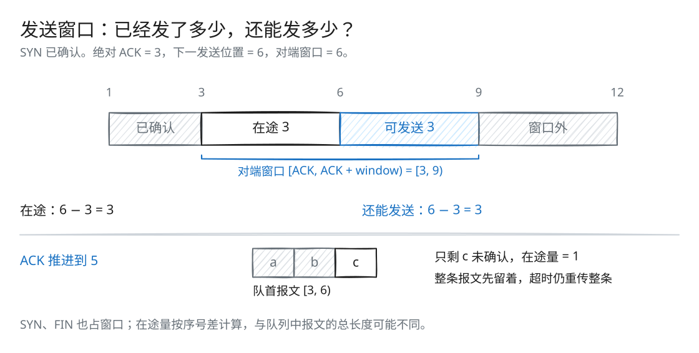
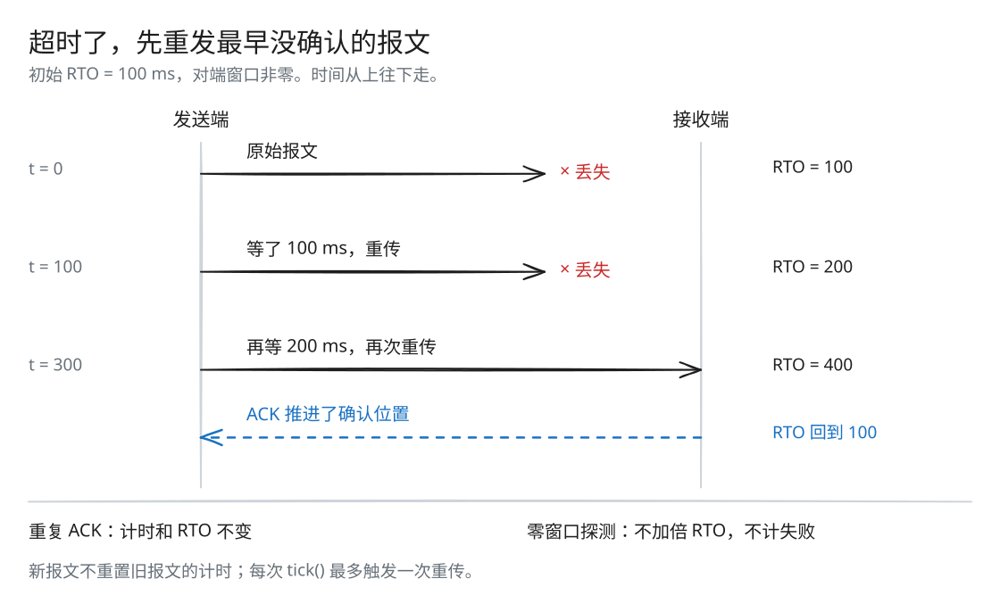

# Lab 3：TCP 发送端、窗口与重传

[返回导读](README.md) · [上一篇：Lab 2](check2.md) · [下一篇：Lab 4](check4.md)

数据发出去了，怎么知道对方收到了？还能继续发多少？TCPSender 用 ACK 跟踪确认进度，用对端的接收窗口限制发送量，并保留未确认的报文，超时后重传。

## 先算还能发送多少



[SVG 原图](assets/sender-window.svg) · [Excalidraw 源文件](assets/sender-window.excalidraw)

使用绝对序号计算：

```text
in_flight = send_count - ack_count
remaining = max(peer_window, 1) - in_flight  # 只在 in_flight < 有效窗口时计算
```

图中下一发送位置是 6，ACK 为 3，说明 `[3, 6)` 的三个序号还没确认。窗口右边界是 3 + 6 = 9，因此还能发送 `[6, 9)`。若窗口缩小到容不下当前在途数据，就先暂停新发送，等待确认。

对端通告零窗口时，发送端按一个序号探测，让对端有机会回复最新窗口。SYN 和 FIN 也各占一个窗口位置。

## 例子：窗口、FIN 和确认

ISN 为 100，先发送 SYN，得到 ACK 101、窗口 4。应用写入并关闭 `"abc"` 后：

```text
seqno = 101
payload = "abc"
FIN = true
sequence_length = 3 + 1 = 4
```

已使用绝对序号总量从 1 增到 5。对端 ACK 105 后，累计确认到 5，在途量归零，报文被释放。

若窗口只有 3，则第一次只能发送 `"abc"`；确认后再用一个窗口位置发送 FIN。

## 先看一次丢包恢复



[SVG 原图](assets/sender-retransmission.svg) · [Excalidraw 源文件](assets/sender-retransmission.excalidraw)

对端窗口非零时，每次超时都重传最早未确认的报文，并将 RTO 加倍。ACK 推进确认位置后，计时器和连续重传次数归零，RTO 恢复初始值。

重复 ACK 不会重置计时；后来发出的新报文，也不会延长最早那条报文的等待时间。

## 源码与状态

实现位于 [src/tcp_sender.cc](../src/tcp_sender.cc)，成员与接口位于 [src/tcp_sender.hh](../src/tcp_sender.hh)。报文与反馈定义分别见 [TCPSenderMessage](../util/tcp_sender_message.hh) 和 [TCPReceiverMessage](../util/tcp_receiver_message.hh)。

| 状态 | 含义 |
| --- | --- |
| `input_` | 应用已写入、发送端尚未读取的载荷 |
| `isn_` | 本发送方向的初始序号 |
| `send_count_` | 已使用的绝对序号长度，也就是下一次新发送的起点 |
| `ack_count_` | 累计确认到的绝对序号 |
| `windows_size_` | 最近一次收到的对端窗口，初始为 1 |
| `syn_`、`fin_` | SYN、FIN 是否已经在新报文中发送过 |
| `retx_queue_` | 尚未完全确认的报文及其排他终点 |
| `initial_RTO_ms_`、`RTO_ms_` | 初始和当前重传超时 |
| `timer_` | 有未确认报文时累计的等待时间 |
| `retx_count_` | 自上次有效 ACK 以来的连续正常超时重传次数 |

`send_count_`、`ack_count_` 统计的是 TCP 序号，不是仅统计载荷的字节数。报文消耗的长度为：

```text
sequence_length = SYN + payload.size() + FIN
sequence_numbers_in_flight = send_count_ - ack_count_
```

正常状态满足 `ack_count_ <= send_count_`。

## push()：把可发送的数据变成报文

### 1. 判断是否还能发送

有效发送窗口为：

```text
window = max(windows_size_, 1)
```

循环继续的条件是：

- 尚未发送 FIN；
- 未确认序号量小于有效窗口；
- 尚未发送 SYN，或有应用载荷，或输入已经结束可以发送 FIN。

满足 `in_flight < window` 后，再计算 `remaining = window - in_flight`。窗口缩小时，已有的在途数据可能超出新窗口，此时等待 ACK 推进即可。

### 2. 填入 SYN 和载荷

报文起始序号由 `wrap(send_count_, isn_)` 得到。首次发送设置 SYN，它占去一个窗口位置。

载荷长度为：

```text
min(MAX_PAYLOAD_SIZE, remaining - SYN, input.bytes_buffered())
```

当前 [TCPConfig](../util/tcp_config.hh) 的 `MAX_PAYLOAD_SIZE` 是 1000 B。先 `reserve()` 载荷空间，然后从 ByteStream 的队首视图按需追加。若一条报文横跨多个字符串块，就循环 `peek()`、`append()`、`pop()`，直到达到本次长度。

### 3. 在输入完成且窗口还有位置时发送 FIN

`input.is_finished()` 同时表示应用已关闭 Writer，且所有输入载荷已经取出。只有报文当前长度小于 remaining 时才能附上 FIN。

因此 FIN 可以与最后一段载荷同发，也可能由于窗口恰好用完而留到下一次。SYN 和 FIN 标记仅在第一次新发送时设置一次，但对应报文可以超时重传。

### 4. 保留重传副本并推进发送位置

调用 `transmit(message)` 后，将报文移动进重传队列，并保存：

```text
end_seqno = 发送前的 send_count_ + message.sequence_length()
```

同时把 `send_count_` 推进到终点。若此前没有未确认报文，把计时器从 0 开始；若旧报文仍在等待确认，发送新报文不会重置最早报文的计时。

载荷离开发送缓冲后，由重传队列接着保存，直到整条报文被累计 ACK 确认。

## receive()：处理对端 ACK 与窗口

每次反馈先更新窗口。即使 ACK 重复、无效或缺失，窗口字段也会影响后续发送。

RST 将输入流标记为错误。其他含 ACK 的反馈通过 `unwrap(isn_, ack_count_)` 还原绝对确认位置。仅当：

```text
ack_count_ < acknowledged <= send_count_
```

时推进累计确认。

确认推进后：

1. 更新 `ack_count_`。
2. 弹出所有 `end_seqno <= ack_count_` 的队首报文。
3. 将连续重传次数归零。
4. 将 RTO 恢复为初始值，计时器归零。

重复 ACK、旧 ACK、确认到从未发送的位置，不推进确认，也不重置 RTO。

若 ACK 只确认了报文的前半段，当前实现保留并重传整条报文，由接收端裁掉重复前缀。因此，在途量按序号差计算，可能小于重传队列中报文的总长度。

## tick()：重发最早未确认报文

重传队列为空时不累计时间，也不发送。否则累加 `ms_since_last_tick`；达到 RTO 时：

1. 重传队首报文，序号、载荷与标记保持原样。
2. 对端窗口非零时，增加连续重传次数，并将 RTO 加倍。
3. 计时器归零，等待下一轮。

零窗口探测不增加连续重传次数，也不使 RTO 加倍，因为对端应用暂时停止读取，并不代表网络传输失败。

一次 `tick()` 最多触发一次重传，超过阈值的余量不会触发多次立即重传。发送端报告连续重传次数；当前 `tick()` 本身不按 `MAX_RETX_ATTEMPTS` 自动停止连接。

## make_empty_message() 的作用

空报文使用当前下一发送序号，并根据输入流错误状态设置 RST。它不携带 SYN、载荷或 FIN，序号长度为 0，不进入发送端的重传队列。

Lab 4 的 TCPPeer 用它发送纯 ACK。ACK 字段由本地 TCPReceiver 生成，用来确认对方的数据；纯 ACK 本身不消耗序号。

## 例子：计时器如何复位

初始 RTO 为 100 ms：

| 事件 | timer | 当前 RTO | 连续重传 |
| --- | ---: | ---: | ---: |
| 新报文进入原本为空的队列 | 0 | 100 | 0 |
| `tick(99)` | 99 | 100 | 0 |
| `tick(1)`，窗口非零，触发重传 | 0 | 200 | 1 |
| 新累计 ACK 推进 | 0 | 100 | 0 |

重复 ACK 不产生最后一行的复位。队列已空后的长时间等待也不会被计入下一条新报文。

## 复杂度与设计取舍

形成报文的成本主要来自读取和复制载荷。一次 ACK 的队列处理是 O(k)，k 为本次完全确认的报文数；`tick()` 的元数据操作是 O(1)。

累计确认总是从前往后释放报文，超时也总是重传最早未确认的一条，因此用 FIFO 队列就能完成管理。

本 Lab 的范围是接收窗口流量控制与超时重传，暂不涉及拥塞控制、快速重传或 SACK。

## 动手推演

一条报文覆盖绝对序号 `[1, 5)`，对端 ACK 从 1 推进到 3。在途量是多少？报文会出队吗？下一次超时重传哪部分？

<details>
<summary>核对答案</summary>

在途量是 5 − 3 = 2。ACK 尚未到达报文终点 5，因此整条报文留在队列中。超时后重传 `[1, 5)`，接收端裁掉已收到的前缀。

</details>

## 验证方式

先按 [导读](README.md#构建与测试) 构建：

```bash
ctest --test-dir build --output-on-failure --timeout 12 -FA compile -R '^send_'
ctest --test-dir build --output-on-failure --timeout 12 -FA compile -R '^protocol_regressions$'
```

测试覆盖 SYN、分段、窗口增长与收缩、FIN 的窗口占用、累计 ACK、无效 ACK、定时器、RTO 退避、零窗口、空闲后重新发送和 RST。双向传输中的联动行为见 [Lab 4](check4.md)。
