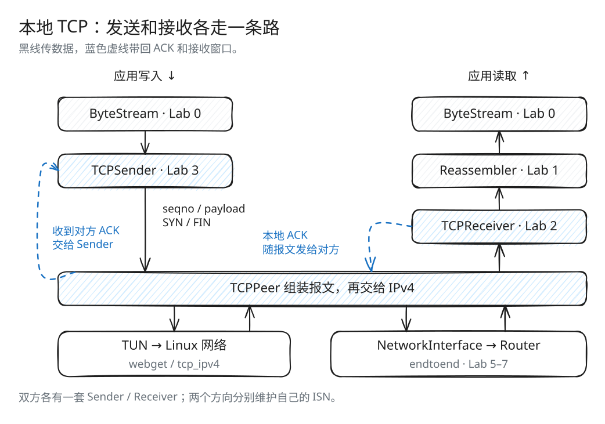
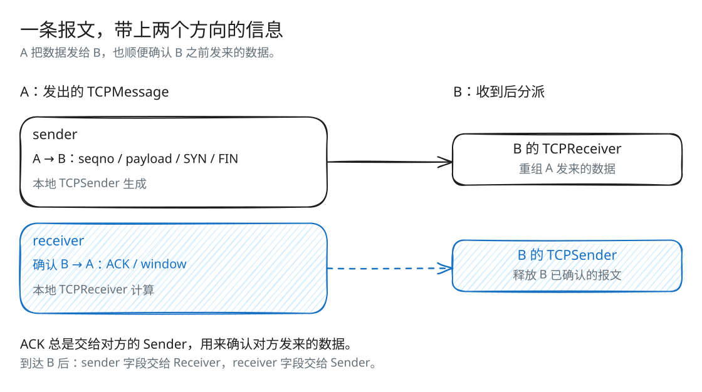
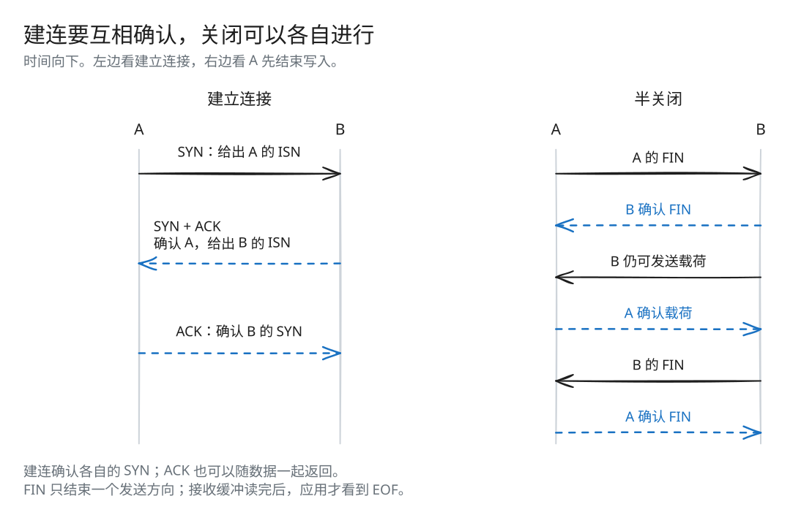

# Lab 4：把组件组成一条 TCP 连接

[返回导读](README.md) · [上一篇：Lab 3](check3.md) · [下一篇：Lab 5](check5.md)

前面的组件已经能发送、接收和重组字节，接下来要让它们一起工作。一条 TCP 连接同时承载两个方向的数据：一边发送，一边接收，还要及时处理 ACK 和超时。Lab 4 看课程框架怎样把这些动作接到应用读写和事件循环上。

## 先看一个端点的两条路径



[SVG 原图](assets/tcp-architecture.svg) · [Excalidraw 源文件](assets/tcp-architecture.excalidraw)

应用写入 → ByteStream → TCPSender → 网络，是本地发送方向。网络 → TCPReceiver → Reassembler → ByteStream → 应用读取，是本地接收方向。每个方向都有自己的进度和结束状态。

TCPPeer 将两条路径组合为连接，TCPMinnowSocket 再把连接包装为应用可以读写的套接字。

## TCPPeer：两个方向放在一条报文中



[SVG 原图](assets/peer-message.svg) · [Excalidraw 源文件](assets/peer-message.excalidraw)

一条 `TCPMessage` 包含：

```cpp
struct TCPMessage {
    TCPSenderMessage sender;
    TCPReceiverMessage receiver;
};
```

`sender` 携带本方向的序号、载荷、SYN 和 FIN；`receiver` 携带对反方向数据的 ACK、接收窗口和 RST。这对应了 TCP 报文既发送数据、又返回确认的行为。

`TCPPeer` 持有本地 sender、receiver，并对应用暴露：

- `outbound_writer()`：应用写入待发送数据。
- `inbound_reader()`：应用读取重组后的数据。
- `push()`：尝试形成新报文。
- `tick()`：推进重传和连接停留时间。
- `receive()`：把收到的数据和反馈交给对应组件。

发送时，`send()` 把 sender 生成的报文与 `receiver_.send()` 的最新反馈合在一起，让 ACK 可以搭着数据一起返回。

## 收到一条报文后如何联动

当前 `receive()` 的顺序是：

1. 仅在连接仍活跃时处理，并记录最近接收时间。
2. 带有序号长度的报文，以及指定的 keep-alive 探测，设置回复需求。
3. 将 `msg.sender` 交给接收端，将 `msg.receiver` 交给发送端。
4. 调用 `push()`，利用新 ACK 或新窗口继续发送，并携带最新接收反馈。
5. 若尚无报文带出所需 ACK，再用 `make_empty_message()` 发纯 ACK。

这样，窗口变大或 SYN 被确认后，发送端就能立即继续发送，无须等待应用下一次写入。

双方通过交换 SYN 和 ACK，分别确定各自方向的初始序号。

## 建立连接与半关闭



[SVG 原图](assets/connection-lifecycle.svg) · [Excalidraw 源文件](assets/connection-lifecycle.excalidraw)

建立连接时，双方各自发出 SYN，确定各自方向的 ISN，并由对方 ACK 确认。示意图把三个交换分开画，实际报文可以把 SYN、载荷和 ACK 合在一起。

关闭也按方向进行：A 发出 FIN 并被确认后，B 仍可向 A 发送载荷。等 B 也发出 FIN，双方各自把已缓存字节读完，应用才分别看到读取 EOF。

## 源码与分工

| 文件 | 分工 |
| --- | --- |
| [util/tcp_peer.hh](../util/tcp_peer.hh) | 把一个发送端和一个接收端组合成双向连接 |
| [util/tcp_segment.hh](../util/tcp_segment.hh)、[.cc](../util/tcp_segment.cc) | TCP 头部、载荷、序列化与校验和 |
| [util/tcp_over_ip.cc](../util/tcp_over_ip.cc) | TCP 与 IPv4 数据报之间的封装和连接过滤 |
| [util/tcp_minnow_socket.hh](../util/tcp_minnow_socket.hh)、[实现](../util/tcp_minnow_socket_impl.hh) | 套接字接口、后台 TCP 线程与事件循环 |
| [src/tcp_minnow_socket.cc](../src/tcp_minnow_socket.cc) | 对 TUN 适配器做模板实例化 |
| [apps/tcp_ipv4.cc](../apps/tcp_ipv4.cc) | 可设置窗口、RTO、丢包率的收发应用 |
| [tests/tcp_integration.cc](../tests/tcp_integration.cc) | 不依赖网络权限的双向集成测试 |

这里的组装与适配主要由课程框架提供，前面实现的四个组件通过接口接入。

## TCPMinnowSocket：应用与 TCP 线程的桥

框架用一对本地 Unix stream socket 隔开前台应用与后台 TCP 线程。

```text
应用 write()
  → 本地 socket pair
  → outbound_writer()
  → TCPSender
  → 数据报适配器
  → 网络

网络
  → 数据报适配器
  → TCPReceiver / Reassembler
  → inbound_reader()
  → 本地 socket pair
  → 应用 read()
```

后台事件循环主要处理三件事：

| 事件 | 动作 |
| --- | --- |
| 网络数据报可读 | 解析报文，调用 `TCPPeer::receive()` |
| 应用写入的数据可读 | 按发送流可用容量读取，写入 outbound，再调用 `push()` |
| 重组数据可交给应用 | 将 inbound 的队首写入本地 socket，仅弹出实际写成功的字节 |

事件循环以约 10 ms 的等待粒度驱动，但 TCP 的 `tick()` 接收实际测量的时间差，定时器单位为毫秒。

应用结束写入时，通过 socket EOF 关闭 outbound Writer；接收流全部结束后，后台关闭面向应用的写方向，让应用读到 EOF。

## TCP 封装到 IPv4

`TCPOverIPv4Adapter::wrap_tcp_in_ip()` 设置端口与 IP 地址，计算长度、TCP 校验和和 IPv4 头部校验和，再序列化。

TCP 校验和还覆盖 IPv4 伪首部中的地址、协议和长度，因此封装时必须使用这条连接的实际地址信息。

解包时，适配器验证 IPv4/TCP 结构与校验和，并过滤不属于当前连接的地址和端口。监听模式在接收到合适的 SYN 后记录对端地址和端口，后续只处理这条连接。

`TCPOverIPv4OverTunFdAdapter` 最终读写 TUN 中的 IPv4 数据报。`LossyFdAdapter` 可在收发两侧随机丢弃报文，用于观察重传。

## 关闭不是只看到一个 FIN

两个方向可以独立结束。当前 `TCPPeer::active()` 综合考虑：

- 输入或输出流是否出错；
- 发送端是否还有未读载荷或未确认序号；
- 接收方向是否关闭；
- 是否还处在完成后的停留期。

需要停留的一方，会在最近一次接收后的 `10 × 初始 RTO` 内继续处理报文，以便再次确认对方重传的尾部。这是课程对连接关闭的简化处理。

应用可以先关闭发送方向、继续读取反方向，这就是半关闭。`wait_until_closed()` 等待后台结束；直接销毁仍运行的 socket 会走强制退出路径。

## 动手推演

A 收到 B 的报文，其中 `sender.payload = "hi"`，`receiver.ackno` 确认了 A 之前发出的数据。这两个字段分别交给 A 的哪个组件？

<details>
<summary>核对答案</summary>

`sender` 交给 A 的 TCPReceiver，重组 `"hi"` 并更新对 B 的 ACK；`receiver` 交给 A 的 TCPSender，释放已确认的发送副本。随后 TCPPeer 尝试继续发送，或发出纯 ACK。

</details>

## 本地集成验证

按 [导读](README.md#构建与测试) 构建后运行：

```bash
ctest --test-dir build --output-on-failure --timeout 12 -FA compile -R '^tcp_integration$'
```

测试建立两个 TCPPeer，客户端发送 256 KiB，服务端反向发送 128 KiB。它确定性地丢弃每第 11 个发送消息、复制每第 17 个未丢弃消息，并交错从队列前后取出报文制造乱序。

接收容量分别为 4096 B、2048 B，读取被延迟并限制速度，确保经历零窗口。ISN 放在 `UINT32_MAX` 附近以覆盖回绕。最终逐字节比较两个方向的内容，检查无错误、无未确认报文、空消息队列和正常退出。

这个测试让 TCP 组件通过内存消息交换数据。包含 IPv4 序列化、ARP 和路由转发的完整路径，见 [Lab 7](check7.md)。

仓库没有单独的 `check4` 目标，本篇使用 `tcp_integration` 和下面的应用测试验证。

## 实网验证与临时 TUN

当前 `webget` 使用 `CS144TCPSocket`，其默认设备是 `tun144`，源地址为 `169.254.144.9`。普通本地测试不需要该设备。

需要实网验证时，在没有现成 `tun144` 的环境中，先保存原 IP 转发值，再使用仓库脚本创建临时设备：

```bash
tcp_lab_previous_forwarding=$(cat /proc/sys/net/ipv4/ip_forward)
sudo bash -e scripts/tun.sh start 144
cmake --build build --target check_webget
sudo bash -e scripts/tun.sh stop 144
sudo sysctl -w "net.ipv4.ip_forward=$tcp_lab_previous_forwarding"
```

创建脚本会设置设备拥有者、地址、接口状态、路由、两条 NAT 规则，并开启 IPv4 转发。`stop 144` 删除设备和对应 NAT 规则，地址与设备路由随设备删除；脚本本身不会恢复 IP 转发，所以最后需恢复保存的值。若测试报错，也应执行两条清理命令。

这套流程用于新建的临时设备；已有实验环境应使用其原有配置与清理方式。

也可以使用 `tcp_ipv4` 与普通 HTTP 服务器交互：

```bash
printf 'GET / HTTP/1.1\r\nHost: cs144.keithw.org\r\nConnection: close\r\n\r\n' |
  build/apps/tcp_ipv4 -d tun144 cs144.keithw.org 80
```

`-w` 设置接收容量，`-t` 设置初始 RTO，`-Lu`、`-Ld` 设置发送与接收侧模拟丢包率。`-l` 是监听模式。源 IP 与端口、目标地址仍要和实际实验网络配置一致。
