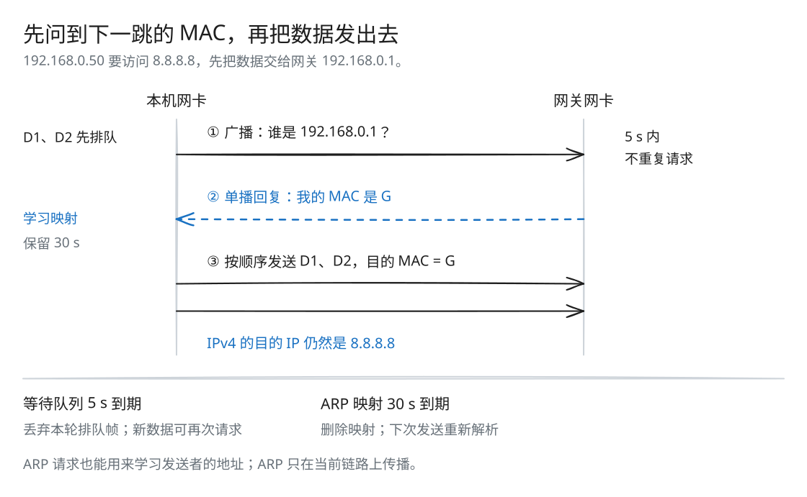

# Lab 5：以太网网卡与 ARP

[返回导读](README.md) · [上一篇：Lab 4](check4.md) · [下一篇：Lab 6](check6.md)

知道目的 IP，为什么还不能直接发送？因为在当前以太网上，帧要交给一张具体的网卡，它由 MAC 地址标识。NetworkInterface 用 ARP 查询下一跳的 MAC，再把 IPv4 数据报装进以太网帧发出去。

## 下一跳 IP 与最终目的 IP

主机要向 8.8.8.8 发数据，本地网关是 192.168.0.1。此时要先把数据报交给网关：

| 字段 | 本例的值 | 表达什么 |
| --- | --- | --- |
| IPv4 目的 IP | 8.8.8.8 | 最终接收者 |
| 传给网卡的下一跳 IP | 192.168.0.1 | 当前链路先交给谁 |
| Ethernet 目的 MAC | 网关对应的 MAC | 当前帧的接收网卡 |

ARP 查询的是下一跳 192.168.0.1，IPv4 的目的 IP 仍是 8.8.8.8。直连目标时，下一跳 IP 就等于最终目的 IP。普通路由转发每经过一条新链路都会换以太网帧，详见 [Lab 6 的转发图](check6.md#route-的完整流程)。

## 先跟踪一次地址解析



[SVG 原图](assets/arp-resolution.svg) · [Excalidraw 源文件](assets/arp-resolution.excalidraw)

不知道 MAC 时，先把 D1 排队，再广播询问下一跳的地址。随后到来的 D2 加入同一队列。收到有效 ARP 报文后，网卡记住发送者的 IP → MAC 映射，并按入队顺序发出等待这个地址的帧。

ARP 请求也写着发送者的地址，因此收到请求就能学习映射。若请求问的正是本机 IP，还要先回复自己的地址，再发送对应的排队帧。

## 源码与依赖

| 文件 | 作用 |
| --- | --- |
| [src/network_interface.hh](../src/network_interface.hh)、[.cc](../src/network_interface.cc) | 网卡状态、收发、ARP 学习与过期 |
| [util/arp_message.hh](../util/arp_message.hh)、[.cc](../util/arp_message.cc) | ARP 请求、回复及解析 |
| [util/ethernet_frame.hh](../util/ethernet_frame.hh) | Ethernet 头部与载荷 |
| [util/ipv4_datagram.hh](../util/ipv4_datagram.hh) | IPv4 头部与载荷 |

网卡使用 `OutputPort::transmit()` 发送帧。测试可以记录这些帧，端到端程序可以把帧放入本地队列或套接字。因此网卡实现不需要知道真实网线或 UDP 转发器的细节。

## 状态设计

| 成员 | 数据结构与含义 |
| --- | --- |
| `arp_table_` | `unordered_map<IP, ARPEntry>`，保存 MAC 和映射过期时间 |
| `frame_queue_` | `unordered_map<IP, PendingFrames>`，保存等待该下一跳解析的帧及过期时间 |
| `datagrams_received_` | 交给上层的已解析 IPv4 数据报队列 |
| `current_time_` | 由 `tick()` 累计的毫秒时间 |
| `ethernet_address_`、`ip_address_` | 本网卡的链路地址与 IP 地址 |

`ARPEntry` 保存已知映射，有效期为 30,000 ms。`PendingFrames` 保存待解析的帧，截止时间为首次请求后的 5,000 ms；这段时间内，同一 IP 不再重复发送 ARP 请求。

## send_datagram() 的发送流程

先构造 IPv4 类型的 EthernetFrame，源 MAC 为本机地址，载荷为 IPv4 数据报的序列化结果，再用 `next_hop.ipv4_numeric()` 查 ARP 表。

### 已知下一跳 MAC

填入目的 MAC，直接调用 `transmit()`。IPv4 数据报的目的 IP 不改成下一跳 IP。

### 未知下一跳 MAC

将已构造的帧移入对应等待队列。如果该 IP 当前没有尚未到期的请求，就设置 5 秒截止时间，发送一个 ARP 请求：

| ARP 字段 | 内容 |
| --- | --- |
| opcode | REQUEST |
| sender_ethernet_address | 本机 MAC |
| sender_ip_address | 本机 IP |
| target_ip_address | 下一跳 IP |

请求帧的目的 MAC 为 Ethernet 广播地址，因为此时还不知道下一跳的 MAC。

截止时间在 `transmit()` 前设置。OutputPort 可以在调用过程中同步交付回复；先更新状态能避免同步回调观察到尚未建立的请求状态。

同一截止时间内再发往同一 IP，只排队数据，不再重复广播 ARP。不同下一跳各有独立等待队列。

## recv_frame() 的接收流程

### 1. 过滤目的 MAC 与帧类型

只接受目的 MAC 为本机或广播的帧。IPv4 类型交给解析器，成功后移动到 `datagrams_received_`。其他非 ARP 类型忽略。

解析器检查报文格式与校验和，只将合法的 IPv4 数据报交给上层。

### 2. 从有效 ARP 报文学习地址

无论收到请求还是回复，都使用发送者的 IP、MAC 更新映射，并把有效期设为：

```text
current_time_ + 30000
```

即使广播请求询问的是其他主机，也可以记住请求方的地址。

### 3. 需要时回复自己的地址

仅当 opcode 为 REQUEST 且 target IP 等于本机 IP 时发送 ARP reply。回复帧单播到请求方 MAC；ARP 的 sender 字段填本机地址，target 字段填请求方地址。

询问其他 IP 的请求不回复。

### 4. 释放等待该发送者映射的帧

新学习的发送者 IP 若有等待队列，就取走队列并删除 map 项，再为每一帧补上目的 MAC，按 FIFO 顺序发送。

先从等待表移除再逐帧发送，使输出过程中的同步回调看到已经完成的解析状态。这个释放动作适用于 ARP 请求和回复两者。

## tick() 如何清理过期状态

`tick(ms)` 增加当前时间，再使用 `erase_if`：

- 删除 `expires_at <= current_time_` 的 ARP 映射；
- 删除 `expires_at <= current_time_` 的等待队列。

截止时间到达即过期。等待队列删除意味着这一轮尚未解析成功的帧被丢弃；后续新调用 `send_datagram()` 可以建立新队列并发起新的 ARP。

`tick()` 只清理过期项。后续发送由新数据触发，上层 TCP 也可以通过重传再次提交数据报。

## 两个计时规则不要混淆

| 对象 | 生命周期 | 到期后发生什么 |
| --- | --- | --- |
| 等待 MAC 的帧队列 | 首次请求起 5,000 ms | 丢弃该轮排队帧；之后的新发送可以再次请求 |
| 已学习的 IP → MAC 映射 | 最近一次学习起 30,000 ms | 删除映射；下次发送重新解析 |

两种时间都由 `tick(ms)` 推进，后到的排队帧不会延长本轮 5 秒的截止时间。

## 性能与边界

平均哈希查找为 O(1)，但报文序列化与解析仍与载荷长度相关。一次 ARP 学习释放 k 条帧的成本为 O(k) 加发送成本。`tick()` 扫描当前两张表，删除等待项还会释放其排队帧。

时间由调用者推进，测试可以精确检查 5 秒和 30 秒两个边界。

## 动手推演

`t = 0` 时向未知 IP A 提交 D1，`t = 4 s` 时提交 D2，期间没有收到 ARP。随后 `tick()` 把时间推进到 `t = 5 s`。D1、D2 还在等待吗？会再次广播吗？

<details>
<summary>核对答案</summary>

两帧都被丢弃：本轮队列仍在 `t = 5 s` 到期，D2 没有延长它。`tick()` 不广播；之后提交 D3，才会建立新队列并发出新 ARP 请求。

</details>

## 验证方式

先按 [导读](README.md#构建与测试) 构建：

```bash
ctest --test-dir build --output-on-failure --timeout 12 -FA compile -R '^net_interface$'
ctest --test-dir build --output-on-failure --timeout 12 -FA compile -R '^protocol_regressions$'
```

测试覆盖未知 MAC 排队、ARP 广播、响应本机请求、从请求学习、解析后释放帧、请求抑制、映射与队列过期，以及帧过滤。完整路由路径见下一篇。
