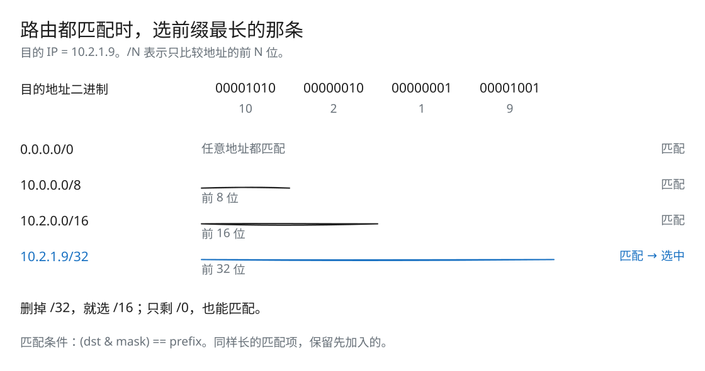
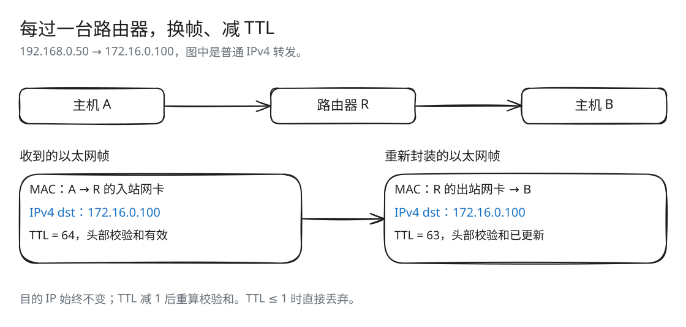

# Lab 6：最长前缀匹配的 IPv4 路由器

[返回导读](README.md) · [上一篇：Lab 5](check5.md) · [下一篇：Lab 7](check7.md)

网卡能把数据送到下一跳，下一跳又该由谁来选？Router 根据 IPv4 目的地址查路由表，找到前缀最长的匹配项，再更新 TTL 和校验和，把数据交给对应网卡。

## 最长前缀匹配



[SVG 原图](assets/routing-prefix.svg) · [Excalidraw 源文件](assets/routing-prefix.excalidraw)

IPv4 地址有 32 位。`/8` 只比较前 8 位，`/16` 比较前 16 位，`/32` 比较完整地址。前缀越长，指定的范围越小；多条路由同时匹配时，就选范围最具体的那条。

图中的 10.2.1.9 同时匹配四条规则，选择 /32。如果删去这条规则，选择 /16，而不是先遇到的 /8。默认路由 /0 不要求任何位相同，所以能匹配所有目的地址。

代码用 `(dst_ip & mask) == normalized_prefix` 判断匹配，遍历时记住前缀最长的一项。若长度相同，当前实现保留先加入的条目。

## 用一个路由表举例

| 前缀 | 输出接口 | 下一跳 |
| --- | --- | --- |
| `0.0.0.0/0` | 0 | `192.0.2.1` |
| `10.0.0.0/8` | 1 | 直连 |
| `10.2.0.0/16` | 2 | `10.1.0.1` |
| `10.2.1.9/32` | 3 | 直连 |

- 发往 `10.2.1.9`：选择 /32，从接口 3 直接查询该主机 MAC。
- 发往 `10.2.5.6`：选择 /16，从接口 2 发给网关 `10.1.0.1`。
- 发往 `10.7.1.2`：选择 /8，从接口 1 直接交付。
- 发往 `8.8.8.8`：选择 /0，从接口 0 发给 `192.0.2.1`。

默认路由也遵循这条规则：掩码为 0，所以任何目的地址都能匹配它。

## 有网关与直连的差别

假设同一个输出网卡上：

| 路由 | next_hop | 发送时交给 NetworkInterface 的目标 |
| --- | --- | --- |
| `10.2.0.0/16` | 空 | 原数据报的目的 IP |
| `172.16.0.0/12` | `10.0.0.172` | 网关 `10.0.0.172` |

第二条路由中，数据报的目的 IP 仍是 `172.16.x.x`，网卡通过 ARP 查询 `10.0.0.172`。网关只负责下一步转发，不能把它写成 IPv4 的最终目的地。

## route() 的完整流程



[SVG 原图](assets/routing-forward.svg) · [Excalidraw 源文件](assets/routing-forward.excalidraw)

对每张网卡的 `datagrams_received()` 队列逐个处理：

1. TTL 为 0 或 1 时，丢弃当前数据报。
2. 对目的 IP 执行最长前缀匹配。
3. 没有匹配条目时，丢弃当前数据报。
4. 有路由时，将 TTL 减 1，重新计算 IPv4 头部校验和。
5. 从路由指定的网卡发出，下一跳由该条目的 optional 网关决定。
6. 弹出输入队列中的数据报，继续下一条。

每次路由转发都要将 TTL 减 1，减到 0 就不能继续发送。因此，TTL 为 0 或 1 的数据报直接丢弃；本 Lab 不生成 ICMP 错误回复。

TTL 改变了 IPv4 头部内容，必须调用 `compute_checksum()` 更新校验和。IPv4 源地址、最终目的地址和载荷不因普通转发而改变。

## 源码与数据结构

实现位于 [src/router.cc](../src/router.cc)，路由条目位于 [src/router.hh](../src/router.hh)。

| 字段               | 含义                                               |
| ---------------- | ------------------------------------------------ |
| `_interfaces`    | `vector<shared_ptr<NetworkInterface>>`，由接口编号访问网卡 |
| `routing_table_` | `vector<routing_item>`，保存转发规则                    |
| `mask_`          | 从前缀长度构造的 32 位掩码                                  |
| `route_prefix_`  | 已经与掩码相与的网络前缀                                     |
| `next_hop_`      | 已知网关 IP；为空时表示直接交付给目的 IP                          |
| `interface_num_` | 选中的输出网卡编号                                        |

`add_interface()` 返回新接口编号，`add_route()` 用这个编号绑定转发规则。

`next_hop_` 有值表示经网关转发，为空表示直连：网卡直接查询目的主机的 MAC。

## 前缀长度怎样变成掩码

对于长度 L：

```text
L = 0：mask = 0
L > 0：mask = ~uint32_t{0} << (32 - L)
normalized_prefix = route_prefix & mask
```

| 前缀长度 | 十六进制掩码 | 表示 |
| --- | --- | --- |
| /0 | 0x00000000 | 默认路由 |
| /8 | 0xff000000 | 匹配前 8 位 |
| /16 | 0xffff0000 | 匹配前 16 位 |
| /24 | 0xffffff00 | 匹配前 24 位 |
| /32 | 0xffffffff | 精确主机路由 |

`/0` 的掩码单独设为 0，其余通过无符号左移构造。这样也覆盖了 `/1` 的最高位和 `/32` 的全部位。接口约定前缀长度为 0–32。

前缀在建表时规范化。例如收到 `10.2.99.4/16`，保存的前缀是 `10.2.0.0`，而不是带有主机部分的原地址。

## 为什么使用线性路由表

本 Lab 的路由表规模小、构建简单，vector 连续存储且遍历直观。对于 R 条路由，一次查找为 O(R)；处理 D 个输入数据报，匹配部分为 O(DR)，另加网卡封装与发送。

大型路由表可以用 Trie 等索引加速查找；本 Lab 用一次线性扫描，足以清楚地表达最长前缀匹配。

## 动手推演

路由表中有 `10.0.0.0/8` → 接口 1 直连，以及 `10.2.0.0/16` → 接口 2、网关 `10.1.0.1`。发往 `10.2.5.6`、TTL 为 2 的数据报如何处理？若 TTL 为 1 呢？

<details>
<summary>核对答案</summary>

TTL 为 2 时选择 `/16`，将 TTL 减到 1，重算 IPv4 头部校验和，从接口 2 发出。网卡查询 `10.1.0.1` 的 MAC，IPv4 目的地址仍是 `10.2.5.6`。TTL 为 1 时直接丢弃。

</details>

## 验证方式

先按 [导读](README.md#构建与测试) 构建：

```bash
ctest --test-dir build --output-on-failure --timeout 12 -FA compile -R '^router$'
ctest --test-dir build --output-on-failure --timeout 12 -FA compile -R '^protocol_regressions$'
```

`router` 测试建立多接口模拟网络，检查本地转发、网关路径、最长前缀、默认路由和 TTL。协议回归另外检查带主机位的前缀规范化、/1 高位掩码，以及转发后校验和和 TTL 是否正确。

`cmake --build build --target check6` 同时覆盖网卡与路由器。Lab 7 再把这两层接到 TCP 的真实字节传输上。
