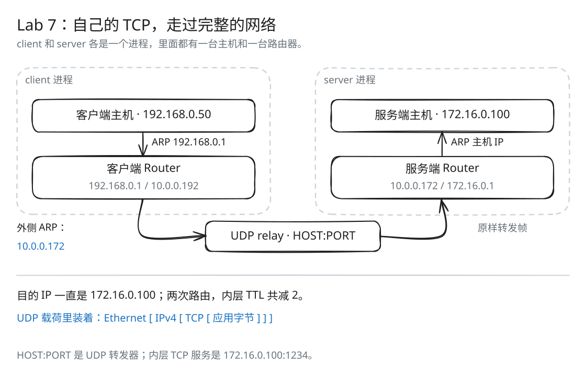

# Lab 7：从主机到主机的完整协议栈

[返回导读](README.md) · [上一篇：Lab 6](check6.md)

前面写好的组件，现在可以一起传文件了。`endtoend` 让应用数据经过自己的 TCP、网卡和路由器，到达另一端后再重组为字节流。两台路由器之间用 UDP 搬运以太网帧，相当于给它们接上一条虚拟网线。

## 程序搭建的拓扑



[SVG 原图](assets/endtoend-path.svg) · [Excalidraw 源文件](assets/endtoend-path.excalidraw)

沿着图中的箭头，数据从客户端主机出发，经过客户端路由器、UDP 转发器和服务端路由器，最后到达服务端主机。每个进程都模拟一台主机和一台路由器。

客户端路由表：

| 前缀 | 下一跳 | 输出侧 |
| --- | --- | --- |
| `192.168.0.0/16` | 直连 | 主机侧 |
| `10.0.0.0/8` | 直连 | 外侧 |
| `172.16.0.0/12` | `10.0.0.172` | 外侧 |

服务端路由表：

| 前缀 | 下一跳 | 输出侧 |
| --- | --- | --- |
| `172.16.0.0/12` | 直连 | 主机侧 |
| `10.0.0.0/8` | 直连 | 外侧 |
| `192.168.0.0/16` | `10.0.0.192` | 外侧 |

客户端主机把远端数据报交给网关 `192.168.0.1`；服务端主机的网关是 `172.16.0.1`。两端路由器的外侧接口通过 UDP 搬运的以太网帧形成虚拟链路。

## 内层负责什么，外层负责什么

| 层次 | 本例的对象 | 负责什么 |
| --- | --- | --- |
| 应用与内层 TCP | 客户端 ↔ 172.16.0.100:1234 | 可靠字节流、ACK、重传和关闭 |
| 内层 IPv4 | 192.168.0.50 ↔ 172.16.0.100 | 跨路由器选择路径，TTL 每次路由减 1 |
| 内层 Ethernet | 各链路的下一跳 MAC | 当前链路交付与 ARP |
| 外层 UDP | 两个进程 ↔ HOST:PORT 的转发器 | 在真实系统网络中搬运序列化的以太网帧 |

UDP 的载荷里装着内层 Ethernet / IPv4 / TCP。外层报文丢失后，内层 TCPSender 会因迟迟收不到 ACK 而超时重传。UDP 转发器只原样搬运帧，可靠传输由两端的 TCP 完成。

## 跟踪一个客户端报文

客户端要发送到 `172.16.0.100:1234`：

1. TCPSender 产生报文，TCPPeer 加上反方向 ACK。
2. 适配器封装 IPv4，目的 IP 仍是 `172.16.0.100`。
3. 客户端主机 ARP 查询 `192.168.0.1`，向本地网关发以太网帧。
4. 客户端路由器匹配 `172.16.0.0/12`，TTL 减 1，更新校验和。
5. 外侧网卡 ARP 查询 `10.0.0.172`，向服务端路由器发帧。
6. UDP 转发器把序列化 EthernetFrame 搬到对方进程。
7. 服务端路由器匹配直连 `172.16.0.0/12`，再次减少 TTL 并更新校验和。
8. 主机侧网卡 ARP 查询 `172.16.0.100`，交付给服务端主机。
9. 服务端解析 TCP，重组载荷，交给应用，并沿反向路径确认。

一个数据报经过两次路由，内层 TTL 共减 2。UDP 转发器搬运的是整个帧，不修改其中的 IPv4 头部。

## 命令行中的 HOST、PORT 是什么

```text
endtoend client HOST PORT [debug]
endtoend server HOST PORT [debug]
```

这里的 HOST、PORT 是 UDP 转发器地址。内层服务端 TCP 地址由程序固定为 `172.16.0.100:1234`。可选 `debug` 会把每条帧的摘要输出到标准错误，便于观察 ARP、目的地址和 TTL。

每个进程启动时向转发器发送三个空 UDP 报文，让转发器知道本进程的外层地址；这些注册报文不携带内层 EthernetFrame。

这条路径使用普通 UDP 和本地 Unix socket，不需要 TUN 或管理员权限。

## 源码入口与分工

核心组装程序是 [apps/endtoend.cc](../apps/endtoend.cc)，其中：

| 类或函数 | 作用 |
| --- | --- |
| `NetworkInterfaceAdapter` | 将 TCP over IPv4 接到自己实现的 NetworkInterface |
| `TCPSocketEndToEnd` | 为应用提供 connect、bind、listen_and_accept |
| `FramesOut` | 接收路由器网卡发出的 EthernetFrame，排队给事件循环 |
| `program_body()` | 创建角色对应的主机、路由器、UDP 通道和网络线程 |
| `bidirectional_stream_copy()` | 在标准输入、输出与应用套接字之间双向搬运字节 |

课程框架负责组装；前面实现的 ByteStream、Reassembler、TCP 发送与接收端、网卡和路由器，都在这条路径中参与传输。

## NetworkInterfaceAdapter 如何连接 TCP 与网卡

适配器内部有自己的 NetworkInterface，以及一对本地 Unix datagram socket。这里用 datagram，是为了保留每个 EthernetFrame 的报文边界。

发送方向：

```text
TCPMessage
  → wrap_tcp_in_ip()
  → IPv4 数据报
  → NetworkInterface::send_datagram(数据报, 主机网关)
  → ARP 或 IPv4 EthernetFrame
  → 本地 datagram socket
  → 路由器网络线程
```

接收方向先从本地 socket 读取一个帧，交给 `NetworkInterface::recv_frame()`。ARP 帧可能让网卡发出回复，但不会产生 TCP 消息；IPv4 帧则进入网卡的接收队列，随后交给 `unwrap_tcp_in_ip()` 解析成当前连接的 TCPMessage。

适配器的 `tick()` 也推进主机网卡的 ARP 时钟。独立网络线程推进路由器两张网卡的时钟。

## 网络线程的四条事件规则

| 方向 | 处理 |
| --- | --- |
| 主机 → 路由器 | 读主机帧，交给主机侧接口，再调用 `router.route()` |
| 路由器 → 主机 | 从主机侧输出队列取帧，写回主机的本地 socket |
| 路由器 → UDP 链路 | 从外侧输出队列取帧，序列化后通过 UDP 发出 |
| UDP 链路 → 路由器 | 解析收到的 EthernetFrame，交给外侧接口，再调用 `router.route()` |

ARP 只在当前链路被网卡处理；路由器不会把 ARP 当成 IPv4 数据报跨接口路由。需要走下一条链路时，输出网卡自行查询该链路上的下一跳 MAC。

## 动手推演

客户端的数据报到服务端要经过几台 Router？内层 TTL 共减多少？如果 UDP 转发器丢掉了一个数据帧，最终由哪个组件重传？

<details>
<summary>核对答案</summary>

经过客户端和服务端两台 Router，内层 TTL 共减 2。内层 TCPSender 等待 ACK 超时后重传，报文重新经过网卡和路由器到达对方。

</details>

## 可复现的本地转发器

在终端 A 启动一个只连接两个进程的 UDP 转发器：

```bash
python3 -u - <<'PY'
import socket

relay = socket.socket(socket.AF_INET, socket.SOCK_DGRAM)
relay.bind(("127.0.0.1", 9000))
peers = []
print("UDP relay listening on 127.0.0.1:9000")
while True:
    frame, sender = relay.recvfrom(65535)
    if sender not in peers:
        peers.append(sender)
    if frame and len(peers) == 2:
        receiver = peers[1] if sender == peers[0] else peers[0]
        relay.sendto(frame, receiver)
PY
```

转发器保留 UDP 报文边界，只原样转发非空载荷。它不参与 ARP、路由或 TCP。

## 双向 1 MiB 文件验证

先按 [导读](README.md#构建与测试) 构建，然后在仓库根目录生成两个不同的文件：

```bash
python3 - <<'PY'
from pathlib import Path
import os

Path("/tmp/cs144-client-input.bin").write_bytes(os.urandom(1024 * 1024))
Path("/tmp/cs144-server-input.bin").write_bytes(os.urandom(1024 * 1024))
PY
```

终端 B 先启动服务端：

```bash
build/apps/endtoend server 127.0.0.1 9000 \
  < /tmp/cs144-server-input.bin \
  > /tmp/cs144-server-output.bin \
  2> /tmp/cs144-server.log
```

终端 C 再启动客户端：

```bash
build/apps/endtoend client 127.0.0.1 9000 \
  < /tmp/cs144-client-input.bin \
  > /tmp/cs144-client-output.bin \
  2> /tmp/cs144-client.log
```

两边正常退出后，在任一终端比较：

```bash
cmp /tmp/cs144-client-input.bin /tmp/cs144-server-output.bin
cmp /tmp/cs144-server-input.bin /tmp/cs144-client-output.bin
```

两条 `cmp` 都无输出且退出码为 0，就说明两个方向的文件都逐字节一致。上面的命令已将日志写入单独文件，标准输出只保留传输内容。完成后，在终端 A 按 Ctrl-C 结束转发器。

每次运行的 MAC、端口和载荷可能不同，用退出码和 `cmp` 判断结果即可。

## 不同测试分别证明什么

| 验证 | 覆盖 |
| --- | --- |
| `tcp_integration` | 内存消息链路上的 TCP 双向、丢包、重复、乱序、零窗口、序号回绕和关闭 |
| `net_interface`、`router` | 帧处理、ARP、路由选择、TTL 和校验和 |
| 本地 `endtoend` 文件传输 | TCP/IPv4 序列化、主机网卡、ARP、两端 Router、UDP 承载与应用读写的完整联动 |
| 与远端实现通过外部转发器通信 | 额外验证跨机器环境、外部链路和双方实现的兼容性 |

要进一步检查与另一份独立实现的兼容性，可以让双方连接同一个外部转发器，完成跨机器传输。

文件较大时无需一次塞满发送缓冲。`bidirectional_stream_copy()` 根据 ByteStream 容量持续读取，并只弹出实际写成功的字节。stdin EOF 触发本方向半关闭，另一方向继续接收，最后由 TCPPeer 的确认与停留逻辑结束连接。
